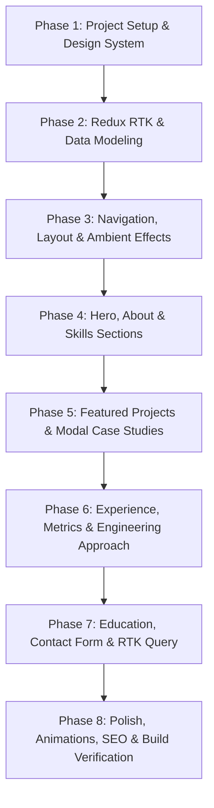

# Master Implementation Plan: Vrushali Pawar's Portfolio

**Target Identity:** Full Stack Developer | Frontend Architecture | AI-Powered Applications  
**Primary Tech Stack:** React.js, Redux Toolkit (RTK) & RTK Query, TypeScript, Tailwind CSS, Framer Motion, Lucide React  
**Design Theme:** Obsidian Black & Neon / Cyber Teal with High-Tech Glassmorphism  
**Document Reference:** [Portfolio_guide.md](file:///c:/Users/Acer/Documents/Vrushali/Portfolio/Portfolio_guide.md) & [techstach.md](file:///c:/Users/Acer/Documents/Vrushali/Portfolio/techstach.md)

---

## 1. Executive Summary & Document Synthesis

### 1.1 Content Strategy Alignment ([Portfolio_guide.md](file:///c:/Users/Acer/Documents/Vrushali/Portfolio/Portfolio_guide.md))
- **Core Positioning:** Avoid generic "coder" tropes; present Vrushali as a well-rounded Full Stack Developer capable of full lifecycle delivery—from scalable frontend architecture and DOM virtualization to async background pipelines (Celery/Redis, FastAPI, NestJS) and practical LLM/AI integrations.
- **Key Artifacts & Sections:**
  1. **Navbar & Brand Bar:** Sticky glassmorphism header, brand mark, section anchor links, and quick Résumé CTA.
  2. **Hero Section:** Clear 5-second value proposition, dual CTAs (*"Explore My Work"*, *"Let's Connect"*), and a 4-point credibility strip (2.5+ years experience, production SaaS, async APIs, AI integrations).
  3. **About Section:** "Engineering products from idea to production" story + 4 core capability cards + engineering philosophy quote.
  4. **Technical Skills:** Domain-grouped capabilities (Frontend, Backend, Databases & Async, AI & Intelligent Workflows, Cloud & DevOps).
  5. **Featured Projects (Case Studies):** 4 anonymized enterprise-grade projects with modal deep-dives:
     - *Project 1:* Enterprise Project Management & Document Intelligence Platform (5,000+ tasks Gantt/virtualized DOM, Celery, FastAPI, AI summaries).
     - *Project 2:* Conversational AI Automation (NestJS, Redis, Webhooks, AI Voice agents, messaging orchestration).
     - *Project 3:* AI-Assisted Form Creation (Natural language & voice to dynamic forms, Zustand/RTK, Supabase, LLM schema generation).
     - *Project 4:* Intelligent Discovery Experience (Debounced search, dynamic filters, REST caching, Next/React hooks).
  6. **Professional Experience & Impact Metrics Strip:** Role breakdown + quantifiable metrics (25% faster load, 31% UI responsiveness, 30% manual input reduction, 5+ SaaS products).
  7. **Engineering Approach ("How I Work"):** 4-step architectural methodology (Understand $\rightarrow$ Architect $\rightarrow$ Build $\rightarrow$ Optimize).
  8. **Education & Certifications:** MIT WPU (CGPA 8.87/10) + Full-Stack Bootcamp.
  9. **Contact & Social Connect:** Interactive contact form with status feedback, 1-click email clipboard copy (`vrushalipawar1802@gmail.com`), LinkedIn, GitHub, and downloadable résumé.
  10. **Footer & SEO Metadata:** Crisp semantic footer and OpenGraph / Meta tags.

### 1.2 Tech Stack Architecture Alignment ([techstach.md](file:///c:/Users/Acer/Documents/Vrushali/Portfolio/techstach.md))
- **Core Framework:** React.js (Vite / Next.js) with TypeScript.
- **State Management:** **Redux Toolkit (RTK)** + **RTK Query** for reactive UI states, dynamic filtering, active project modals, global toast alerts, and simulated/live portfolio data services.
- **Styling & Theme Engine:** Tailwind CSS configured with custom color tokens and CSS custom properties for rich Obsidian & Teal palettes.
- **Interactions & Micro-animations:** Framer Motion for scroll-driven reveals, hover physics, staggered lists, and modal transitions.
- **Icons:** Lucide React for consistent, lightweight visual language.
- **Form Handling & Messaging:** RTK-controlled form state integrated with Web3Forms/Formspree or serverless API endpoint.

---

## 2. Design System: Black & Teal Color Palette

The visual design delivers a sleek, futuristic, and professional engineering aesthetic. Pure `#000000` is avoided in favor of deep obsidian layers with cool undertones, contrasted with high-voltage cyber teal and soft cyan accents.

### 2.1 Color Palette Specifications

| Token Name | Hex Code | HSL | Semantic Role |
| :--- | :--- | :--- | :--- |
| **Obsidian Base** | `#080b0e` | `210°, 27%, 4%` | Root page background, deep canvas |
| **Obsidian Surface** | `#0e141a` | `210°, 30%, 8%` | Card background, section containers |
| **Obsidian Elevated** | `#141e26` | `206°, 31%, 12%` | Hovered cards, modal dialogs, floating panels |
| **Border Subtle** | `#1c2a36` | `207°, 31%, 16%` | Inactive borders, grid dividers |
| **Border Glowing** | `#00f2d4` (15-30% $\alpha$) | `173°, 100%, 47%` | Active card borders, focus rings |
| **Cyber Teal (Primary)** | `#00f2d4` | `173°, 100%, 47%` | Primary accents, CTAs, highlight badges, icons |
| **Deep Aquatic Teal** | `#0d9488` | `175°, 84%, 32%` | Button hover gradients, secondary badges |
| **Ice Cyan (Secondary)** | `#38bdf8` | `199°, 89%, 60%` | AI features, secondary gradient stop, links |
| **Mint Emerald (Accent)** | `#10b981` | `160°, 84%, 39%` | Success states, live metrics, "Open to work" badge |
| **Text Bright (Primary)** | `#f1f5f9` | `210°, 40%, 96%` | Headings, primary copy |
| **Text Muted (Secondary)**| `#94a3b8` | `215°, 16%, 65%` | Paragraph descriptions, metadata, subtitles |
| **Text Dark/Dim** | `#64748b` | `215°, 14%, 47%` | Disclaimers, subtle timestamps |

### 2.2 Visual Effects & Glassmorphism Tokens
- **Background Mesh Gradient:**
  ```css
  radial-gradient(ellipse 80% 50% at 50% -20%, rgba(0, 242, 212, 0.12), transparent),
  radial-gradient(ellipse 60% 40% at 90% 80%, rgba(56, 189, 248, 0.08), transparent)
  ```
- **Glass Card Treatment:**
  ```css
  background: rgba(14, 20, 26, 0.75);
  backdrop-filter: blur(12px);
  -webkit-backdrop-filter: blur(12px);
  border: 1px solid rgba(0, 242, 212, 0.15);
  box-shadow: 0 8px 32px 0 rgba(0, 0, 0, 0.37);
  ```
- **Neon Glow Utility:**
  ```css
  box-shadow: 0 0 25px -5px rgba(0, 242, 212, 0.35);
  ```
- **Text Gradient Utility:**
  ```css
  background: linear-gradient(135deg, #f1f5f9 20%, #00f2d4 80%, #38bdf8 100%);
  -webkit-background-clip: text;
  -webkit-text-fill-color: transparent;
  ```

---

## 3. Redux Toolkit (RTK) & State Architecture

Redux Toolkit is leveraged purposefully to demonstrate scalable enterprise state management, separating concerns cleanly across specialized slices:

```
src/store/
├── index.ts                   # Store configuration & root reducer
├── hooks.ts                   # Typed useAppDispatch & useAppSelector
├── slices/
│   ├── uiSlice.ts             # Navigation, mobile drawer, active section, toast alerts
│   ├── projectSlice.ts        # Project filters, active case study modal, search query
│   ├── skillSlice.ts          # Active skill category, selected tech tag filter
│   └── contactSlice.ts        # Form draft state, submission status, feedback messages
└── api/
    └── portfolioApi.ts        # RTK Query service for project data & contact dispatch
```

### 3.1 State Tree Blueprint

```typescript
export interface RootState {
  ui: {
    activeSection: string;               // e.g. 'hero' | 'about' | 'projects' | 'contact'
    mobileNavOpen: boolean;
    activeModal: string | null;          // ID of currently opened project modal
    toast: {
      message: string;
      type: 'success' | 'info' | 'error';
      visible: boolean;
    } | null;
    resumeDownloadedCount: number;
  };
  projects: {
    selectedCategory: 'all' | 'fullstack' | 'frontend' | 'ai';
    searchQuery: string;
    starredProjects: string[];
    activeCaseStudyId: string | null;
  };
  skills: {
    activeCategory: 'all' | 'frontend' | 'backend' | 'data' | 'ai' | 'cloud';
    highlightedSkill: string | null;
  };
  contact: {
    formData: {
      name: string;
      email: string;
      message: string;
    };
    status: 'idle' | 'loading' | 'success' | 'error';
    errorMessage: string | null;
  };
}
```

### 3.2 RTK Query Feature (`portfolioApi.ts`)
- Implements `useGetProjectsQuery()` and `useSendContactMessageMutation()`.
- Caches project case study data with automatic invalidation and optimistic UI updates for interactive likes/stars or feedback.

---

## 4. Component Hierarchy & Directory Architecture

```
vrushali-portfolio/
├── public/
│   ├── resume.pdf
│   ├── favicon.svg
│   └── assets/images/
├── src/
│   ├── main.tsx
│   ├── App.tsx
│   ├── index.css
│   ├── store/
│   │   ├── index.ts
│   │   ├── hooks.ts
│   │   ├── slices/
│   │   └── api/
│   ├── data/
│   │   ├── portfolioData.ts     # Projects, skills, experience, education data
│   │   └── constants.ts
│   ├── components/
│   │   ├── layout/
│   │   │   ├── Navbar.tsx
│   │   │   ├── MobileDrawer.tsx
│   │   │   ├── Footer.tsx
│   │   │   └── Toast.tsx
│   │   ├── common/
│   │   │   ├── Button.tsx
│   │   │   ├── GlassCard.tsx
│   │   │   ├── SectionHeader.tsx
│   │   │   ├── Badge.tsx
│   │   │   └── GlowOrb.tsx
│   │   ├── sections/
│   │   │   ├── HeroSection.tsx
│   │   │   ├── CredibilityStrip.tsx
│   │   │   ├── AboutSection.tsx
│   │   │   ├── WorkPillars.tsx
│   │   │   ├── SkillsSection.tsx
│   │   │   ├── ProjectsSection.tsx
│   │   │   ├── ProjectCard.tsx
│   │   │   ├── ProjectModal.tsx
│   │   │   ├── ExperienceSection.tsx
│   │   │   ├── ImpactMetrics.tsx
│   │   │   ├── ApproachSection.tsx
│   │   │   ├── EducationSection.tsx
│   │   │   └── ContactSection.tsx
│   └── types/
│       └── portfolio.ts
├── tailwind.config.js
├── tsconfig.json
└── package.json
```

---

## 5. Detailed Step-by-Step Implementation Roadmap



---

### Phase 1: Environment Setup & Design System Foundation
- **Step 1.1:** Scaffold project using React 18+ with TypeScript via Vite (`npm create vite@latest . -- --template react-ts`).
- **Step 1.2:** Install production dependencies:
  - `@reduxjs/toolkit` and `react-redux`
  - `tailwindcss`, `postcss`, `autoprefixer`
  - `framer-motion`
  - `lucide-react`
  - `canvas-confetti` (for celebratory contact form submissions)
- **Step 1.3:** Configure `tailwind.config.js` with bespoke colors:
  - Obsidian tokens: `obsidian-950` (`#080b0e`), `obsidian-900` (`#0e141a`), `obsidian-800` (`#141e26`), `obsidian-border` (`#1c2a36`).
  - Teal tokens: `teal-neon` (`#00f2d4`), `teal-deep` (`#0d9488`), `cyan-ice` (`#38bdf8`), `mint-accent` (`#10b981`).
- **Step 1.4:** Define typography using modern fonts (Inter or Plus Jakarta Sans) and import via Google Fonts.
- **Step 1.5:** Create standard reusable atoms: `<Button />`, `<GlassCard />`, `<Badge />`, `<SectionHeader />`.

---

### Phase 2: State Infrastructure & Typed Data Layer
- **Step 2.1:** Create `src/types/portfolio.ts` defining data contracts for Projects, Skills, Experience, Education, and Contact submissions.
- **Step 2.2:** Create `src/data/portfolioData.ts` consolidating the verified copy and metrics from [Portfolio_guide.md](file:///c:/Users/Acer/Documents/Vrushali/Portfolio/Portfolio_guide.md).
- **Step 2.3:** Set up Redux Toolkit store:
  - Configure `uiSlice`, `projectSlice`, `skillSlice`, and `contactSlice`.
  - Export custom typed hooks: `useAppDispatch` and `useAppSelector`.
- **Step 2.4:** Build RTK Query endpoints for asynchronous simulation and message submission.

---

### Phase 3: Core Layout, Navigation & Ambient Background
- **Step 3.1: Ambient Background (`<GlowOrb />`)**
  - Subtle interactive ambient light spots that float softly behind content with low opacity and high blur (`blur-3xl`).
- **Step 3.2: Sticky Glass Navbar (`<Navbar />`)**
  - Left: Vrushali Pawar logo mark with a pulsing teal badge (*"Open to Opportunities"*).
  - Center: Desktop anchor links (About, Skills, Projects, Experience, Process, Contact) with active section highlight via Redux `activeSection`.
  - Right: Quick Action: *"Download Résumé"* button with teal glow hover effect.
  - Mobile: Hamburger toggle triggering a sliding `<MobileDrawer />` with Framer Motion.
- **Step 3.3: Global Toast System (`<Toast />`)**
  - Connected to `uiSlice.toast` to display notifications (e.g., *"Email copied to clipboard"* or *"Message sent successfully"*).

---

### Phase 4: Hero, Credibility Strip & About Section
- **Step 4.1: Hero Section (`<HeroSection />`)**
  - Status pill: *"Available for Frontend & Full Stack Roles"*.
  - Headline: *"Building thoughtful digital experiences with scalable engineering."*
  - Sub-headline & Bio: Copy directly from Section 3 of `Portfolio_guide.md`.
  - Interactive Action Row:
    - Primary CTA: *"Explore My Work"* (smooth scrolls to `#projects`).
    - Secondary CTA: *"Let's Connect"* (smooth scrolls to `#contact`).
    - Tertiary CTA: *"Download Résumé"* (triggers download + Redux counter + toast).
- **Step 4.2: Credibility Strip (`<CredibilityStrip />`)**
  - 4 quick proof points:
    1. 2.5+ Years Professional Development
    2. Production SaaS Application Development
    3. Frontend Architecture & Asynchronous APIs
    4. Practical AI & LLM Integrations
- **Step 4.3: About Section (`<AboutSection />`)**
  - Heading: *"Engineering products from idea to production"*.
  - Narrative paragraphs explaining full-lifecycle capabilities.
  - Engineering Philosophy blockquote with teal left-border accent.
- **Step 4.4: 4 Work Pillars Grid (`<WorkPillars />`)**
  - Cards: Frontend Engineering, Backend Development, Practical AI Integration, Performance & Architecture.
  - Staggered entry animation with glowing hover borders.

---

### Phase 5: Technical Skills Showcase
- **Step 5.1: Skills Section (`<SkillsSection />`)**
  - Category filter tabs powered by Redux (`skillSlice`):
    - All Skills
    - Frontend Architecture
    - Backend Development
    - Databases & Asynchronous Processing
    - AI & Intelligent Workflows
    - Cloud, Deployment & Integrations
- **Step 5.2: Skill Pill Components**
  - Each skill badge displays an icon, name, and capability tooltip or contextual tag.
  - Dynamic highlight when a user clicks a related filter.

---

### Phase 6: Featured Projects & Interactive Case Studies
- **Step 6.1: Projects Filter Bar (`<ProjectsSection />`)**
  - Filter pills: All, Full Stack SaaS, AI & Automation, High-Performance Frontend.
  - Search input to filter by tech tag (e.g. "FastAPI", "React", "NestJS", "Zustand").
- **Step 6.2: Featured Project Cards (`<ProjectCard />`)**
  - Displays generic project title, 2-line problem summary, key metrics badge, tech stack tags, and *"View Case Study"* button.
  - Hover effect: Card tilts slightly with a teal gradient border sweep.
- **Step 6.3: Interactive Case Study Modal System (`<ProjectModal />`)**
  - Managed globally by `projectSlice.activeCaseStudyId`.
  - When opened, renders full breakdown:
    - Business Problem & Context
    - Engineering Challenge
    - What Vrushali Built (detailed bullet points)
    - Architecture & Technical Decisions
    - Measurable Outcomes (e.g., 5,000+ scheduled tasks, 30% flow completions, 15% retention).
    - Sanitized architectural workflow diagram / UI mockup placeholder.

---

### Phase 7: Experience, Impact Strip & Engineering Process
- **Step 7.1: Professional Experience Timeline (`<ExperienceSection />`)**
  - Software Product Engineering (Feb 2024 – Present).
  - Structured responsibility breakdown with clean vertical glowing line connector.
- **Step 7.2: Quantitative Impact Strip (`<ImpactMetrics />`)**
  - Counters / highlight cards:
    - `25%` Faster frontend loading
    - `31%` Improved UI responsiveness
    - `30%` Reduced manual input via AI
    - `5+` Responsive SaaS applications delivered
- **Step 7.3: Engineering Approach 4-Step Grid (`<ApproachSection />`)**
  - 01. Understand the Problem
  - 02. Design for Maintainability
  - 03. Build Across the Stack
  - 04. Optimize and Iterate

---

### Phase 8: Education, Contact & Interactive Features
- **Step 8.1: Education & Certifications (`<EducationSection />`)**
  - MIT World Peace University, Pune (B.Tech CSE, 2019–2023, CGPA: 8.87 / 10).
  - Full-Stack Web Development Bootcamp (Comprehensive engineering training).
- **Step 8.2: Contact Section (`<ContactSection />`)**
  - Heading: *"Have an interesting problem to solve? Let's talk."*
  - Left column: Contact info cards:
    - Email with 1-click copy button (`vrushalipawar1802@gmail.com`).
    - LinkedIn link (`linkedin.com/in/VrushaliPawar293`).
    - GitHub link (`github.com/Vrushali-Pawar18`).
    - Download Résumé button.
  - Right column: Interactive contact form (Name, Email, Subject, Message):
    - Managed by `contactSlice` with input validation.
    - Submit dispatches RTK mutation $\rightarrow$ triggers success alert + confetti animation.
- **Step 8.3: Footer (`<Footer />`)**
  - Copyright 2026 Vrushali Pawar.
  - Quick jump links and *"Back to Top"* button.

---

### Phase 9: Quality Assurance, Performance Audits & Deployment
- **Step 9.1: SEO & Head Metadata**
  - Title: `Vrushali Pawar | Full Stack Developer & Software Engineer`
  - Description: Full description from Section 11 of `Portfolio_guide.md`.
  - Open Graph social share image and favicon.
- **Step 9.2: Accessibility & Keyboard Navigation (a11y)**
  - ARIA attributes on modals, dialogs, drawers, and form fields.
  - Visible focus indicators matching the teal theme (`focus-visible:ring-2 focus-visible:ring-[#00f2d4]`).
- **Step 9.3: Performance & Responsive Testing**
  - Zero layout shift (CLS), optimized font loading, lazy loading for heavy project cards/modals.
  - Mobile responsiveness verification (320px, 375px, 768px, 1024px, 1440px).
- **Step 9.4: Deployment Pipeline**
  - GitHub repository configuration.
  - Vercel or Netlify 1-click CI/CD deployment with custom domain readiness.

---

## 6. Implementation Deliverables Checklist

- [ ] Project initialized with Vite + React + TypeScript + Tailwind CSS
- [ ] Black & Teal theme tokens configured in `tailwind.config.js` and `index.css`
- [ ] Redux Toolkit store configured (`uiSlice`, `projectSlice`, `skillSlice`, `contactSlice`)
- [ ] Complete content and project dataset created in `src/data/portfolioData.ts`
- [ ] Sticky Glass Navbar + Mobile Drawer implemented
- [ ] Hero Section with dual CTAs and Credibility Strip built
- [ ] About Section + 4 Work Pillars created
- [ ] Categorized Technical Skills with RTK category filters built
- [ ] 4 Featured Projects grid + Deep-dive Case Study Modals implemented
- [ ] Professional Experience timeline & 4 Quantitative Metrics cards added
- [ ] Engineering Approach ("How I Work") 4-step workflow added
- [ ] Education & Certifications card built
- [ ] Contact Section with 1-click email copy & interactive form built
- [ ] Global Toast notification system connected
- [ ] Smooth scrolling & Framer Motion entrance animations integrated
- [ ] Responsive design verified across mobile, tablet, and desktop
- [ ] Production build verified (`npm run build`)
